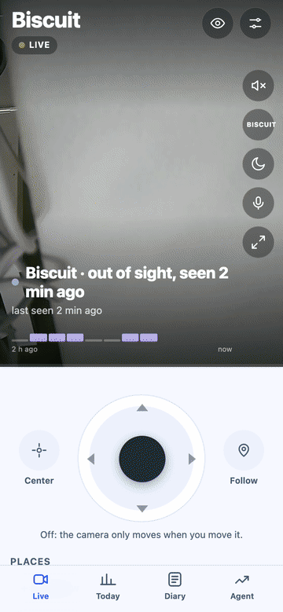

<p align="center">
  <picture>
    <source media="(prefers-color-scheme: dark)" srcset="docs/brand/openpetcam-logo-horizontal-white.svg">
    
  </picture>
</p>

<p align="center"><b>The open-source pet camera that knows your pet.</b><br>
Live video, your pet's day at a glance, and a camera that goes looking when they wander off.<br>
On a $5 server you own. No subscription. No vendor cloud.</p>

<p align="center">
  <a href="https://github.com/crimeacs/OpenPetCam/actions/workflows/ci.yml"></a>
  <a href="LICENSE"></a>
  <a href="https://github.com/crimeacs/OpenPetCam/releases"></a>
  <a href="CONTRIBUTING.md"></a>
</p>

<p align="center"></p>

## Install in three steps

You need a [Thingino](https://thingino.com)-flashed pan/tilt camera on your Wi-Fi (the reference is a Cinnado D1)
and any Ubuntu 24.04 server with a public IP (an AWS Lightsail nano at $5/month is plenty).

```bash
git clone https://github.com/crimeacs/OpenPetCam.git && cd OpenPetCam
git checkout "$(git describe --tags --abbrev=0 2>/dev/null || echo main)"   # the latest release
./setup
```

`./setup` asks for the server's IP and SSH key, installs everything, tells you exactly what to type into the
camera's WireGuard page, has you set a password on the server, and prints the address to open on your phone.
Then *Share → Add to Home Screen*: it runs full screen like an app, with no App Store. It updates itself every night.

<details><summary>Prefer to do it by hand?</summary>

### Set it up by hand

You need:
- a Thingino-supported pan/tilt camera (reference: Cinnado D1, Ingenic T23N);
- a Linux VM with a public IP running Ubuntu 24.04 (reference: AWS Lightsail `nano_3_0`, $5/month);
- a Mac or Linux computer with `git`, `ssh` and `rsync`.

1. **Flash the camera** with Thingino ([supported cameras and instructions](https://thingino.com)), join it to
   your Wi-Fi and set its root password in the setup portal.
2. **Create the server.** Open TCP 22, 80 and 443, plus UDP 51820 (WireGuard) and UDP 8189 (WebRTC media), in
   the cloud firewall. Note its public IP and SSH key.
3. **Get the latest release and configure it:**
   ```bash
   git clone https://github.com/crimeacs/OpenPetCam.git && cd OpenPetCam
   git checkout "$(git describe --tags --abbrev=0)"     # the latest release, so it can update itself
   cp config/site.env.example config/site.env           # then fill it in
   ```
   Fill in the pet's name, pronoun and description, the server IP, a host name and the time zone. A free host
   name that needs no DNS is `petcam.<ip-with-dashes>.sslip.io`.
4. **Deploy:** `./deploy.sh`. It downloads the models (pinned by SHA-256), installs MediaMTX, Caddy and WireGuard,
   and starts everything. It prints the server's WireGuard public key.
5. **Connect the camera.** In Thingino's WireGuard page fill in address `10.77.0.2/24`, endpoint
   `<server IP>:51820`, peer public key (the key printed in step 4), allowed IPs `10.77.0.1/32` and keepalive
   `25`. Copy the camera's public key into `CAMERA_WG_PUBKEY` in `config/site.env`, then run `./deploy.sh` again.
6. **Set the passwords** on the server, interactively: `ssh -t <server> 'sudo /opt/petcam/set-secrets.sh'`.
   It asks for the web app password and the camera's web login, and optionally a new RTSP login (change the
   default `thingino`/`thingino`).
7. **Open** `https://<PUBLIC_HOST>` on your phone, sign in once, and *Share → Add to Home Screen*. Opened from
   the Home Screen it runs full screen and can send notifications. Invite others from Settings.

</details>

## What you get

<p align="center"></p>

- **See them, always.** Live video with sound on your phone, and what they're doing (resting, active, out of
  view) over the picture.
- **It finds them.** Out of view for a while? The camera sweeps the room and stops on them, looking where it
  already points first so it doesn't move for nothing. Or tap **Find**.
- **It knows them from their toys.** A second model, trained on *your* camera's pictures, checks every sighting.
- **Their day at a glance.** Today shows the moments they were in view, naps, activity and every bark. The Diary
  keeps two weeks, with a nightly highlight reel and a timelapse.
- **Alerts.** Barking, distress sounds, camera offline, view blocked.
- **Private by design.** Video goes from your camera to your server and nowhere else. One tap turns off the
  picture **and** the microphone. Family joins with an invite link, not a shared password.
- **Yours to theme.** Cobalt, Golden or Meadow, light or dark.

## It fixes itself, and shares the fix

Tap **Something wrong?** in the app and say what happened. If you run the optional agent on your computer
(`bash tools/install_autopilot.sh`, uses [Claude Code](https://claude.com/claude-code)), it reads your report and
the video around it, writes a fix with a test, checks it against held-out data, ships it to your server and answers
you in the app. The **Agent** tab shows its goals, what it's working on and every decision.

Because it's open source, a fix proven on one camera is offered here as a pull request, and once it's released
every camera installs it overnight. **[Join the open-source pet community →](#help-make-it-better)**

## Help make it better

OpenPetCam gets better every time a pet owner tells us what went wrong, and every fix reaches every camera
overnight. You don't need a camera or any coding to help:

- **Tried it?** Open an [issue](https://github.com/crimeacs/OpenPetCam/issues/new/choose) and say what your pet
  did that the camera got wrong, or what you wish it did. That's the most useful thing there is.
- **Have a different camera?** Tell us whether it works with Thingino and what you had to change.
- **Like to code?** Pick an issue, add a test, open a pull request. Most of the code runs in simulations on a
  laptop; [CONTRIBUTING.md](CONTRIBUTING.md) gets you running in five minutes.
- **Running the agent?** Its proven fixes come here as pull requests on their own. Keep `CONTRIBUTE=pr` and your
  camera helps everyone's.

## How it fits together

```
camera (Thingino, home Wi-Fi) ──WireGuard (the camera dials out; no ports open at home)──▶ your server
server: MediaMTX (video in, WebRTC out, 6 h rolling recording) · petcam-watch (detection, search, follow, sounds)
        petcam-app (the web app) · petcam-alert (push alerts) · petcam-update (nightly releases) · Caddy (HTTPS)
your computer (optional): the agent, which proposes, tests and ships fixes
```

It runs at about 5% of one CPU core on a 512 MB server. Details: [architecture](docs/architecture.md) ·
[camera notes](docs/camera-thingino.md) · [performance](docs/performance.md) · [the agent](docs/superagent.md).

## Updates

Once a day (around 04:20 server time) the server checks this repository's
[releases](https://github.com/crimeacs/OpenPetCam/releases). When there is a newer one it:
1. downloads it and checks its SHA-256;
2. keeps a copy of what is running;
3. installs it with the same `install.sh` that `./deploy.sh` uses;
4. checks that the app answers and the watcher sees pictures again within 3 minutes;
5. puts the previous version back if not, and never retries that release.

Settings in the app shows the version and the last check. Your settings, passwords, keys, trained pet model,
recordings and history are not part of a release, so an update never touches them.

- **Turn it off:** `UPDATE_CHANNEL=off` in `config/site.env`, then `./deploy.sh`. The app still tells you when a
  release is out.
- **Your own fork:** `UPDATE_REPO=you/your-fork`.
- **Running your own changes:** a server deployed from a checkout that is not exactly a release tag (for example
  `v0.1.0-3-gabc1234`, or with uncommitted changes) is never overwritten automatically. `./deploy.sh` updates it.
- **Publishing a release** (maintainers): add a `## [X.Y.Z]` section to `CHANGELOG.md`, then
  `git tag vX.Y.Z && git push --tags`. The release workflow runs the checks and attaches the archive.

## Teach it your pet

```bash
python3 -m venv .venv && .venv/bin/pip install onnxruntime numpy pillow
.venv/bin/python tools/bootstrap_pet.py all      # collect crops, label them with `claude -p`, train, report
.venv/bin/python tools/bootstrap_pet.py deploy   # after reading the report
```

Out of the box the verifier asks "is this any dog breed?". The labeller is told about your pet and its lookalikes
(`PET_DESCRIPTION`, `PET_LOOKALIKES`); labels are cached, so a re-run only labels new crops. A trained verifier
replaces the default only once there are enough labels across at least 3 days to test it honestly on held-out
days, and `./deploy.sh` refuses to replace a trained verifier with the default. The 👍/👎 answers in the app are the
human labels used to check it. Method and numbers: [docs/evaluation.md](docs/evaluation.md).

## The agent (optional)

If you use [Claude Code](https://claude.com/claude-code), `bash tools/install_autopilot.sh` runs an agent on your
computer that treats what goes wrong as feedback and fixes it:

- **"Something wrong?"** in the app files a report with the frame, the 90 s of video before it and what the phone
  showed. The agent diagnoses it, writes a fix with a test, ships it through the checks below and answers you in
  the app.
- **Goals** in `agent/goals.json` (find success, CPU, freshness, reports answered, QA) are measured every 30 min.
  A missed goal becomes work.
- **Every change is judged by things it can't edit:** tests, a guard against removed assertions, a held-out replay
  of detection and search, a shadow run for anything that changes how frames become "your pet", a health check
  with rollback, and a check 24 h later. Rejected attempts are kept and shown to the next attempt.
- **Fixes are shared.** When a fix has run live and healthy on your install, the agent opens a pull request to this
  repository so every install gets it. The PR carries a public summary and the checks it passed; nothing from your
  home (frames, clips, times, names, addresses) goes in, and the public-repo guard and your pet's name are checked
  again before anything is pushed. Needs a fork as `origin` and `gh` signed in; `CONTRIBUTE=off` keeps fixes local.
- **Watch it** in the app's **Agent** tab: goals with 7-day trends, what it's working on, every decision.
  **Steer it** in plain words: edit `agent/steer.md`, or tell Claude Code.

Design and the research it draws on: [docs/superagent.md](docs/superagent.md).

## Secrets and privacy

| What | Where | In git? |
|---|---|---|
| Pet name, server address, time zone, SSH settings | `config/site.env` on your computer; non-SSH parts copied to `/etc/petcam/site.env` | no (git-ignored) |
| Web app password (PBKDF2 hash only), session key, camera web login | `/etc/petcam/app.env` on the server, mode 640, set by `set-secrets.sh` | no, never leaves the server |
| Camera RTSP login | `/etc/petcam/camera.env` | no |
| Web push keys, WireGuard private key | generated on the server by `install.sh` | no |
| Frames, crops, labels and reports from your home | `eval/` on your computer | no (git-ignored) |

Enable the guard once per clone: `git config core.hooksPath .githooks`. The pre-commit hook
(`tools/check_public.sh`) refuses any commit that contains your server's IP or host name, your camera's address,
a private key or other secret-shaped strings. Run `tools/check_public.sh --all` before publishing a fork.

Phones stay signed in with a device cookie; the server stores only its SHA-256 hash, and a device can be revoked
from Settings. Login attempts are rate-limited.

## Repository

| Path | What |
|---|---|
| `server/` | everything that runs on the server, plus `install.sh` and `update.py` |
| `config/site.env.example` | the one file you fill in |
| `deploy.sh` | sync and install from your computer |
| `tools/` | run on your computer: `bootstrap_pet.py`, `status.sh` (health report), `triage.py` (reports), `calibrate.py`, `replay.py` (held-out replay), `superagent.py` (the agent), `make_release.sh` |
| `agent/` | the agent's goals, steering, policies and prompts |
| `tests/server/` | simulations that run anywhere (tracker, presence, search, updates) and checks that run against a live install |
| `docs/` | architecture, camera notes, evaluation, performance, the agent, research |

## Limits

- **Dogs first.** The sound model listens for dog classes and the default verifier asks "is this any dog breed?".
  Cats would need different classes in `verifier.json` and `watch.py`.
- **One camera per server.**
- **Tested on one camera model** (Cinnado D1, Ingenic T23N). Pan/tilt geometry is calibrated per mount
  (`tools/calibrate.py`); some motor quirks may be specific to that model.
- **Detection runs every 8 s while she moves and every 30 s when the picture is still**, not on every frame, to
  fit the $5 server's CPU budget. Searches and follows detect continuously while the camera moves.

## Credits and licenses

OpenPetCam is Apache-2.0 (see `LICENSE`). It builds on:
- [Thingino](https://github.com/themactep/thingino-firmware) (camera firmware);
- [MediaMTX](https://github.com/bluenviron/mediamtx) (MIT);
- [Caddy](https://caddyserver.com) (Apache-2.0);
- [WireGuard](https://www.wireguard.com);
- [YOLOX](https://github.com/Megvii-BaseDetection/YOLOX) (Apache-2.0);
- [MobileNetV2 from the ONNX model zoo](https://github.com/onnx/models) (Apache-2.0);
- [YAMNet](https://github.com/tensorflow/models/tree/master/research/audioset/yamnet) (Apache-2.0);
- [pywebpush](https://github.com/web-push-libs/pywebpush).

The models are downloaded at deploy time, not stored in this repository.
