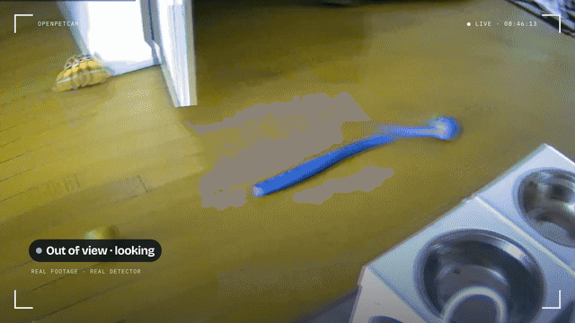

<p align="center">
  <picture>
    <source media="(prefers-color-scheme: dark)" srcset="docs/brand/openpetcam-logo-horizontal-white.svg">
    
  </picture>
</p>

<p align="center"><b>A pet camera that knows your pet, and goes looking when they wander off.</b><br>
OpenPetCam (Open Pet Cam) is open source. Runs on a small server you own. No subscription, no vendor cloud.<br>
<a href="https://openpetcam.com/"><b>Website &amp; 60-second film →</b></a></p>

<p align="center">
  <a href="https://github.com/crimeacs/OpenPetCam/actions/workflows/ci.yml"></a>
  <a href="LICENSE"></a>
  <a href="https://github.com/crimeacs/OpenPetCam/releases"></a>
  <a href="CONTRIBUTING.md"></a>
</p>

<p align="center"></p>

## What it is

You put a cheap pan/tilt Wi-Fi camera in your home, and open an app on your phone. OpenPetCam then:

- **shows them live**, with sound, and says what they're doing (resting, active, out of view);
- **finds them**: when they leave the picture, the camera turns and searches the room until it sees them again,
  or you tap **Find**;
- **knows them from their toys**: a small model trained on *your* camera's pictures checks every sighting;
- **keeps their day**: naps, activity, barks and short clips on a timeline, a nightly highlight reel and a timelapse;
- **tells you when it matters**: barking, distress sounds, camera offline, view blocked.

Everything runs on hardware you control. Video goes from your camera to your server and nowhere else.

## What you need

| | What | Notes |
|---|---|---|
| 📷 | A pan/tilt Wi-Fi camera that runs [Thingino](https://thingino.com) | The reference is a Cinnado D1. Thingino is free, open firmware you flash onto it. |
| 🖥️ | A small Linux server with a public IP (Ubuntu 24.04) | Any cloud VM works. The reference is an AWS Lightsail nano at $5/month, which is at the edge of its CPU allowance; a plan with a little more sustained CPU is comfortable ([Server size](docs/performance.md#server-size)). |
| 💻 | A Mac or Linux computer, once | For the 15-minute setup. Needs `git`, `ssh` and `rsync`. |
| 🐕 | A pet | Dogs first: the sound model and the default verifier are tuned for dogs. |

## Set it up

**1. Flash the camera** with Thingino ([instructions](https://thingino.com)), join it to your Wi-Fi and set its
password.

**2. Run the setup** on your computer:

```bash
git clone https://github.com/crimeacs/OpenPetCam.git && cd OpenPetCam
git checkout "$(git describe --tags --abbrev=0 2>/dev/null || echo main)"   # the latest release
./setup
```

It asks for your server's address and SSH key, installs everything, tells you exactly what to type into the camera's
WireGuard page (the camera dials out to your server, so nothing is opened on your home network), and has you set a
password.

**3. Open it on your phone.** Go to the address `./setup` prints, sign in, then *Share → Add to Home Screen*. It
runs full screen like an app and can send notifications. Invite family from Settings.

That's it. The server installs new releases by itself every night ([how updates work](docs/updates.md)).
Prefer to do each step yourself? [Install by hand](docs/install.md).

## Using it


- **Live**: tap the picture to aim the camera, drag the joystick to look around, hold to talk to them. **Find**
  searches the room now; **Follow** keeps them in view on its own; **Pause** turns off the picture *and* the microphone.
- **Today**: the moments they were in view, naps and activity, every bark, and the clips.
- **Room** (optional, once you build your room model): your room in 3D as the camera measured it, where your pet is
  and where they spent the day (scrub the day strip), where the camera is pointing, and every view of the model
  (night picture, materials, surface direction, what sound measured). It stays on your server.
- **Something wrong?** Tap it and say what happened (for example "she's in view but it says she isn't"). It saves
  the picture and the video around it, so the problem can be found and fixed.

<br clear="right">

## How it works

```
 your home                                   your server
┌──────────────────────┐  WireGuard (camera   ┌───────────────────────────────────────────┐
│ camera (Thingino)    │  dials out; nothing  │ MediaMTX: video in, live view out,        │
│  motors · video · mic│ ───────────────────▶ │           6 h rolling recording           │
└──────────────────────┘  opened at home      │ watcher:  detects, follows, finds, sounds │
                                              │ app:      the web app on your phone       │
 your phone ◀──── HTTPS + live video ──────── │ Caddy:    HTTPS                           │
                                              └───────────────────────────────────────────┘
```

Detection is two steps: a small general detector (YOLOX-nano) proposes "an animal is here", and a verifier
trained on your own camera's pictures decides whether it is *your* pet (so a plush toy is not). Search turns the
camera through the places your pet is usually found first, then sweeps the room.
The **room model** (`sim/world/`, optional) turns the camera's own sweep, its infrared light, its speaker and
microphone, its WiFi link and where your pet walks into a measured 3D model of your room: rotation-only
self-calibration, learned depth fused into one range per direction and scaled by the floor echo, blind spots above
and below the camera filled by sound where it is shown to hold, and an uncertainty map that says where to look
next. Find uses it to search the likeliest views first; the app shows it in the Room tab. Every claim it makes has
a check against a different sensor and a null (`sim/world/AUDIT.md`); your model and its results stay in your own
`eval/` folder and on your server. See [sim/world/README.md](sim/world/README.md).
More: [architecture](docs/architecture.md) · [camera notes](docs/camera-thingino.md) · [performance](docs/performance.md).

## It gets better on its own (optional)

- **It learns your pet.** `tools/bootstrap_pet.py` trains the verifier on your camera's pictures, and your 👍/👎 in
  the app check it ([how](docs/teach-your-pet.md)).
- **It learns your camera and your pet's habits.** A simulator fitted from the camera's own logs tunes how it follows
  and where it looks first, and every change is tested live against the old behaviour before it stays
  ([how, with the numbers](docs/follow-learning.md)).
- **It fixes what goes wrong.** With [Claude Code](https://claude.com/claude-code) on your computer,
  `bash tools/install_autopilot.sh` runs an agent that reads your "Something wrong?" reports, writes a fix with a test,
  checks it against held-out data, ships it and answers you in the app. Fixes that work are offered back here as pull
  requests ([the agent](docs/superagent.md)).

## Questions

**Is my video private?** Video goes from the camera to your server and nowhere else. One tap pauses the picture and the
microphone together. Passwords and keys stay on the server; family joins with an invite link
([privacy and secrets](docs/privacy.md)).

**Which cameras work?** Any pan/tilt camera Thingino supports should, but only the Cinnado D1 (Ingenic T23N) is tested.
Tell us if you try another.

**Cats?** Not yet: the sound classes and the default verifier are for dogs (`verifier.json`, `watch.py`).

**More than one camera?** One camera per server for now.

**What does it cost?** The camera, plus the server (about $5-7 a month in the cloud). The optional agent uses your
Claude Code plan.

## Help make it better

You don't need a camera or any code to help:

- **Tried it?** [Open an issue](https://github.com/crimeacs/OpenPetCam/issues/new/choose) and say what your pet did
  that the camera got wrong. That is the most useful thing there is.
- **Have a different camera?** Tell us whether it works with Thingino and what you changed.
- **Like to code?** Most of the code runs in simulations on a laptop. Run `tools/run_tests.sh` (no camera or server
  needed), pick an issue, add a test, open a pull request. [CONTRIBUTING.md](CONTRIBUTING.md) gets you going in five
  minutes.

| Path | What |
|---|---|
| `server/` | everything that runs on the server, plus `install.sh` and `update.py` |
| `config/site.env.example` | the one file you fill in (`./setup` does it for you) |
| `tools/` | run on your computer: setup helpers, training, the agent, `run_tests.sh`, `make_release.sh` |
| `sim/` | the camera-and-pet simulator, its calibration, policy training and the live before/after report |
| `tests/` | `server/` and `sim/` run anywhere; `onserver/` needs a running install |
| `docs/` | install, updates, privacy, architecture, camera notes, performance, learning, the agent |

## Credits and licenses

OpenPetCam is Apache-2.0 (see `LICENSE`). It builds on
[Thingino](https://github.com/themactep/thingino-firmware) (camera firmware),
[MediaMTX](https://github.com/bluenviron/mediamtx) (MIT), [Caddy](https://caddyserver.com) (Apache-2.0),
[WireGuard](https://www.wireguard.com), [YOLOX](https://github.com/Megvii-BaseDetection/YOLOX) (Apache-2.0),
[MobileNetV2 from the ONNX model zoo](https://github.com/onnx/models) (Apache-2.0),
[YAMNet](https://github.com/tensorflow/models/tree/master/research/audioset/yamnet) (Apache-2.0) and
[pywebpush](https://github.com/web-push-libs/pywebpush). The models are downloaded at deploy time, not stored here.
The room model and Room tab use [three.js](https://threejs.org) (MIT, vendored in `server/vendor/`),
[Depth Anything 3](https://github.com/ByteDance-Seed/Depth-Anything-3) (BASE, Apache-2.0) and
[ALIKED](https://github.com/Shiaoming/ALIKED) + [LightGlue](https://github.com/cvg/LightGlue) (BSD/Apache-2.0).
